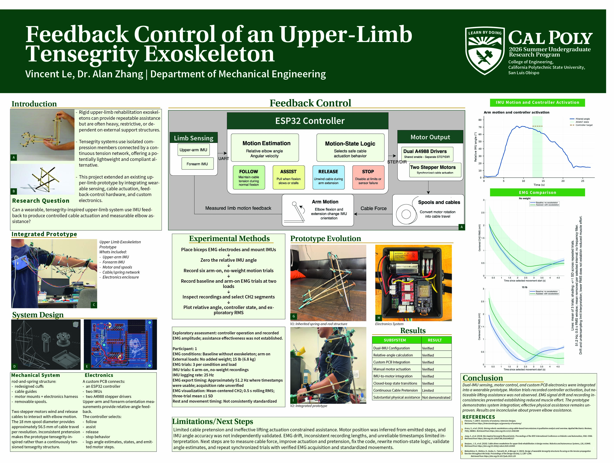

# Research results and figures

The collection documents integrated motion sensing, controller activity, custom electronics, and mechanical iterations. Effective physical assistance and reduced muscle effort remain unproven.

- `figures/imu/`: six-trial overview and individual Trial 3 poster figure.
- `figures/emg/`: exploratory CH2 outputs and the distinct combined-channel preview figures.
- `figures/assets/`: original prototype photos, architecture drawings, and poster assets.
- `poster/source-and-previews/finalposter.jpg`: the developed research poster preview.
- `poster/source-and-previews/`: additional historical preview/template assets, not all final deliverables.

The poster preview was visually reviewed for content selection. It is a preserved research artifact, not evidence that every plotted quantity has been independently validated. Its EMG comparison uses a different presentation pipeline/window from the CH2 whole-record processor; do not imply the two outputs are identical methods.

Large poster PDFs and Illustrator/InDesign sources remain in the SURP archive. The blank template and draft containing result placeholders are not presented as the final poster. See [storage](../docs/storage.md) and [limitations](limitations.md).
